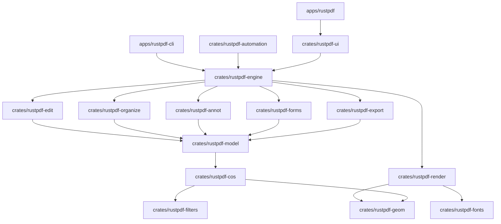

# RustPdf — Architecture & Design

RustPdf is architected from first principles as an independent, modular, pure-Rust PDF workbench.

---

## Architectural Principles

1. **Clean-Room Implementation**:
   - Zero code, assets, or fonts derived from Adobe products or proprietary repositories.
   - Core behavior designed directly to the ISO 32000-1 and ISO 32000-2 specifications.
   - Clean layer separation preventing circular dependencies.

2. **Decoupled Document Model**:
   - All document inspection, page structure manipulation, and serialization live in UI-independent crates (`rustpdf-cos`, `rustpdf-model`, `rustpdf-organize`, `rustpdf-edit`).
   - The user interface (`rustpdf-ui`) is purely a presentation layer that interacts with the document engine via the `DocumentSession` facade.

3. **Asynchronous & Responsive Rendering**:
   - Page rasterization runs strictly off the main thread in a multi-worker `RenderPool`.
   - The UI never blocks on expensive decompression, font rasterization, or tile generation.
   - Bounded caching ensures multi-hundred-page documents never cause out-of-memory crashes.

4. **Safety & Atomic Persistence**:
   - All saving operations use an atomic copy-on-write strategy:
     `Document -> tempfile -> fsync -> parse validation -> atomic OS replace`.
   - The original file on disk is never altered until the new file has been fully verified.

---

## Layered Crate Hierarchy

---

## Component Responsibilities

### 1. `rustpdf-geom`
Foundational geometry types:
- `Point`: 2D vector coordinates.
- `Rect`: Bounding box with intersection, union, and containment tests.
- `Transform`: 3x3 affine transformation matrix for rotation, translation, scaling, and skewing.
- `PageUnits`: High-precision conversions between PDF Points (`pt`), Millimeters (`mm`), Inches (`in`), and Pixels (`px`).

### 2. `rustpdf-cos`
The Carousel Object Structure (COS) low-level representation:
- Encapsulates `lopdf::Document`, `lopdf::Object`, `lopdf::Dictionary`, `lopdf::Array`, and `lopdf::Stream`.
- Safe accessors to traverse direct and indirect object references without panicking on corrupted streams.

### 3. `rustpdf-model`
Domain-level document object graph:
- `DocumentModel`: Aggregates document metadata, page models, outline hierarchy, and encryption state.
- `PageModel`: Resolves page dimensions, effective crop box, and orientation.
- `OutlineNode`: Hierarchical bookmarks tree.

### 4. `rustpdf-render`
Asynchronous page rasterization and text extraction:
- `RenderPool`: Thread pool dispatching rendering requests.
- `effective_scale` & `device_pixels`: Bounds raster sizes to `MAX_SIDE = 8192` and `MAX_PIXELS = 64M`.
- `PageText`: Extracts glyphs with bounding boxes and provides line-grouped, reading-order text search.

### 5. `rustpdf-organize`
Structural page tree mutations:
- `rotate_pages`: In-place rotation adjustment.
- `delete_pages`: Page removal with minimum-1-page invariant.
- `insert_blank_page`: Blank page insertion.
- `combine_documents`: Multi-file merging with object renumbering.
- `split_document`: Segment extraction by chunk size or range.

### 6. `rustpdf-edit`
Safety and transaction history:
- `HistoryStack`: Snapshot command pattern enabling deep Undo (<kbd>Ctrl+Z</kbd>) and Redo (<kbd>Ctrl+Y</kbd>).
- `save_atomic`: Guarantees corruption-free writes.

### 7. `rustpdf-ui`
Desktop immediate-mode workbench in `egui`:
- `AppTheme`: Reactive semantic design tokens, color picker, JSON export/import.
- `ThumbnailConfig`: Grid density, card corner radius, shadows, size presets.
- `ViewerComponent`: Continuous, single-page, and two-up scrolling views.
- `OrganizerComponent`: Multi-selection thumbnail grid.
